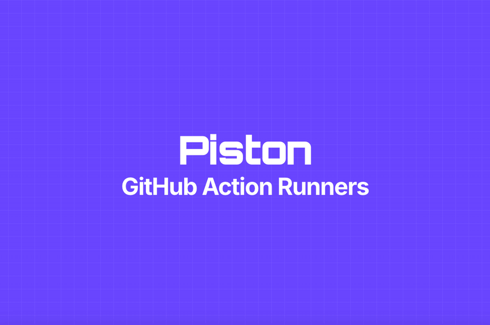
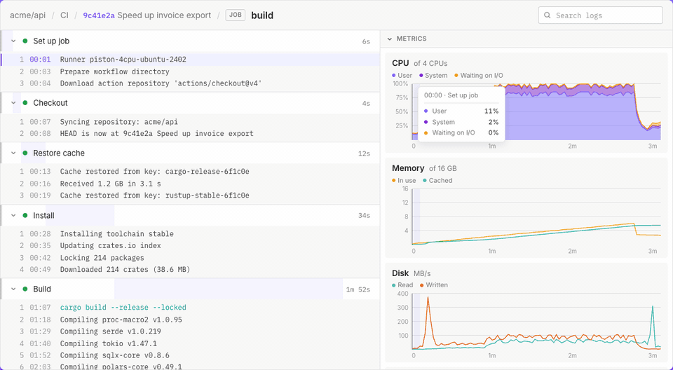
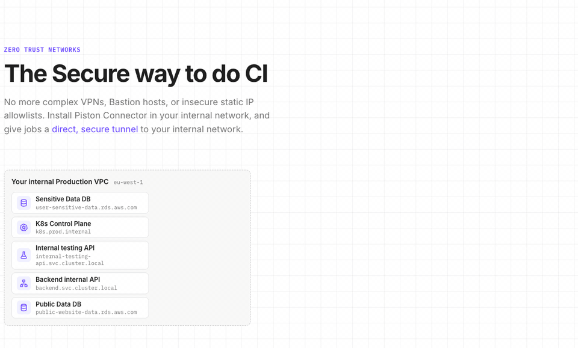
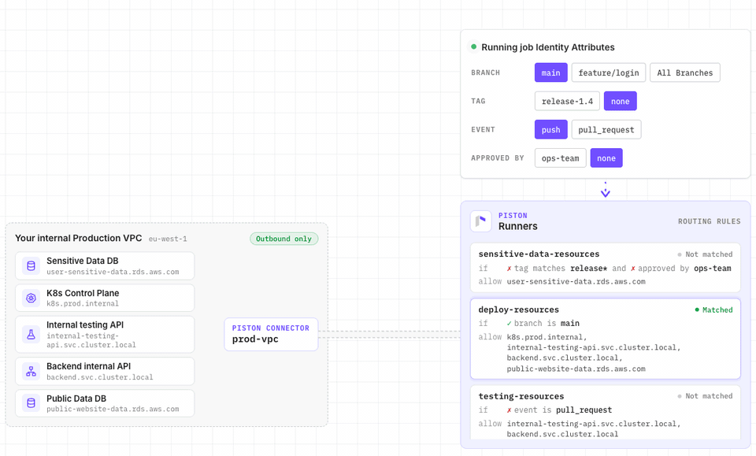
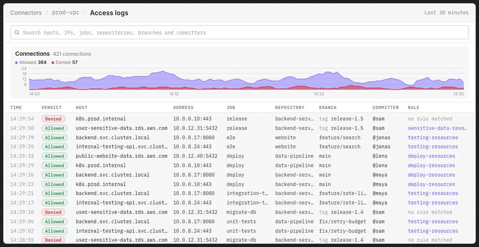
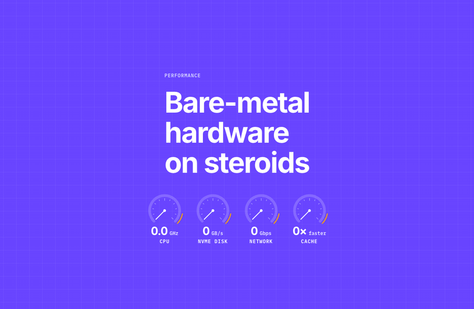
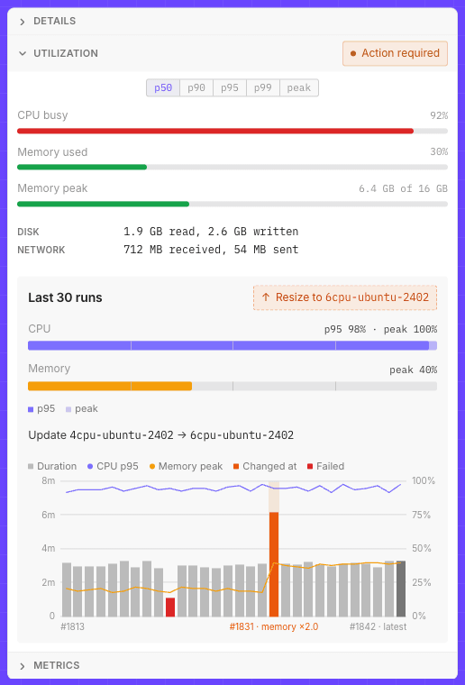

<a href="https://piston.sh">
  <picture>
    <source media="(prefers-reduced-motion: reduce)" srcset="assets/hero.png">
    
  </picture>
</a>

### The fastest way to run GitHub Actions at a fraction of the cost.

| Reduced cost | Faster builds | Faster cache |
| :---: | :---: | :---: |
| up to 70% | up to 3× | up to 4× |

### Move your CI to Piston

One line in your workflow. Everything else stays the same.

```diff
 jobs:
   build:
-    runs-on: ubuntu-latest
+    runs-on: piston-8cpu-ubuntu-2402
     steps:
       - uses: actions/checkout@v4
```

[Get started](https://app.piston.sh), or read the [docs](https://piston.sh/docs/).

### Best-in-class tracing

An unmatched UX. The same GitHub job logs but with far more performance and machine metrics visibility, correlating each log line with metrics.

<picture>
  <source media="(prefers-reduced-motion: reduce)" srcset="assets/tracing.png">
  
</picture>

### The Secure way to do CI

No more complex VPNs, Bastion hosts, or insecure static IP allowlists. Install Piston Connector in your internal network, and give jobs a direct, secure tunnel to your internal network.

<picture>
  <source media="(prefers-reduced-motion: reduce)" srcset="assets/secure.png">
  
</picture>

#### How it works

A network connector is a small program you run in your network, with Docker or on Kubernetes. It connects out to Piston, so you don't forward a port to it. A job reaches what sits behind it by adding one step, and proves who it is with the token GitHub gives it for that run, so there's no long-lived secret in your workflow. The connector checks every connection against your routing rules, and a job's tunnel closes when its run ends.

#### Set it up

1. In the Piston console, open **Network connectors**, click **New network connector** and name it. Then run the line it shows, which has your connector's id and a private key. The key is shown once, so save it.

   ```sh
   helm install piston-connector oci://ghcr.io/getpiston/charts/piston-connector \
     --version <version> \
     --namespace piston-connector --create-namespace \
     --set connectorConfigs.connectorId=<connector id> \
     --set connectorConfigs.privateKey=<private key>
   ```

   A [Docker line](https://piston.sh/docs/connectors/create-a-connector/) is there too, for one machine that can reach your services.

2. On the connector's **Settings** tab, [add a routing rule](https://piston.sh/docs/connectors/routing-rules/): which jobs may connect, by repository, environment and branch, and what they reach, by network CIDR or hostname. Until it has one, no job can connect.

3. [Add the tunnel step](https://piston.sh/docs/connectors/use-in-a-job/) before the steps that need your network, and give the job the `id-token: write` permission.

   ```yaml
   jobs:
     migrate-db:
       runs-on: piston-4cpu-ubuntu-2402
       permissions:
         contents: read
         id-token: write
       steps:
         - uses: actions/checkout@v4
         - uses: getpiston/tunnel-action@v2
           with:
             connector_name: prod-vpc
         - run: ./migrate.sh
   ```

### Fine-grained access by identity

Jobs in your GitHub should never have full unrestricted network access. Piston Connector uses GitHub job identities to power strong, rule-based access control to every resource in your network.

<picture>
  <source media="(prefers-reduced-motion: reduce)" srcset="assets/access.png">
  
</picture>

### Deep network observability

Access logs of every internal network access made by your jobs with their identity, giving you visibility and audit of what your CI accessed in your network.

<picture>
  <source media="(prefers-reduced-motion: reduce)" srcset="assets/observability.png">
  
</picture>

### Bare-metal hardware on steroids

For performance we threw in the kitchen sink: the highest-frequency CPUs, hyper-performant NVMe disks, a 4× faster colocated GitHub cache and up to 10 Gbps network download speed.

<picture>
  <source media="(prefers-reduced-motion: reduce)" srcset="assets/hardware.png">
  
</picture>

### The right size for the job

Deep observability into resource percentiles during execution lets Piston suggest or auto-tune the right size for your job.

<picture>
  <source media="(prefers-reduced-motion: reduce)" srcset="assets/sizing.png">
  
</picture>

---

[piston.sh](https://piston.sh) &nbsp;&nbsp; [Docs](https://piston.sh/docs/) &nbsp;&nbsp; [Log in](https://app.piston.sh) &nbsp;&nbsp; [info@polyform.io](mailto:info@polyform.io)
